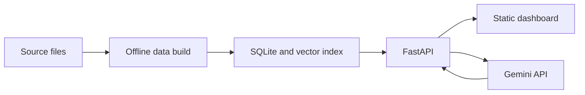

# FlameLedger implementation plan

NASA Space Apps Challenge 7 · Flame in Freefall  
Codex development handoff · 15 November 2026

**Build goal.** Given a proposed cabin environment, FlameLedger shows which NASA tests are relevant, which conditions match, and where the indexed evidence falls short. A judge can open a cited run, compare it with another run, and download the evidence behind the comparison.

**Deployment target.** One Linux VPS with 4 GB RAM, 4 vCPUs and 20 GB free SSD. Use the existing fine-tuned EmbeddingGemma 2 checkpoint for retrieval and the Gemini API for summaries. Re-index the corpus with the deployed checkpoint. Retraining is outside the build scope.

## 1. Start here in Codex

Place this file in the repository root. Give the coding agent access to the project directory and the NASA source files you want to use. Keep the model checkpoint available as a local artifact or through the team's existing private storage. Put API keys in the runtime environment.

Open the project repository in Codex and paste this prompt.

> Read `FlameLedger_Implementation_Plan.md` and the repository's existing `AGENTS.md` if present. Inspect the repo, source data, uploaded model run, and deployment setup. Start with M0, then implement the first incomplete milestone, keeping the app runnable after each change. Continue through the remaining milestones and do independent work when an input is missing. Run and report the acceptance checks and update the status log. Never label fixture data as NASA evidence, claim unmeasured model performance, or retrain the embedder to recover a missing artifact. Use the existing checkpoint once its identity and serving index are verified. Implement the animated pixel-art design in §10, including its reduced-motion behavior and performance budgets.

- The expected model artifact is the exported SentenceTransformer directory `runs/full/model_ft` from Colab, including its tokenizer and pooling configuration. The notebook is a reference and does not contain the trained weights.
- The October 28 NASA package is a separate input. Inventory the actual files before coding a parser. The source choices below are grounded in public records. Confirm their relationship to the package in the repository manifest.
- Reuse any existing application structure. If starting fresh, use the layout in §5. Deployment requires VPS access and a public HTTPS URL. A custom domain is optional. Local development can proceed with checked-in public evidence files and a disabled Gemini provider.
- Keep a short status in the repo covering completed milestones, verification commands, measured results, and missing inputs. Avoid adding architecture or dependencies solely for future scale.

## 2. Notebook audit and decisions

**Input reviewed.** `NASA_Embedder_v3_final(1).ipynb` has 26 notebook cells. It is byte-for-byte identical to `NASA_Embedder_v3_final.ipynb` (SHA-256 `50520f22369d769c4a2622255c3f62488626f42dc7a115c0e1a23dd181c3b98a`). Cell numbers below are the labels inside the notebook. The conclusions are from source code and saved output, plus a local run of the notebook’s pure-Python helper tests and targeted CPU reproductions. Treat the actual Drive bundle and any later results as separate inputs to verify.

| Notebook cells | What the saved run shows | Development decision |
| --- | --- | --- |
| 1–4 | Colab L4, `transformers 5.22.1`, `sentence-transformers 6.2.0`, `torch 2.11.0+cu130`. Helper tests passed in the saved run. | Start compatibility checks from the recorded library versions. Pin a tested CPU-only serving environment. Keep the GPU training dependencies out of it. |
| 5–6 | 486 chunks from 399 NTRS papers, including 399 abstracts and 87 body chunks. Only 10 papers have full-text body chunks. Train/dev/test are 321/39/39 papers and 386/49/51 chunks. The post-ingestion topic filter kept 399/399 papers. No PSI import is shown in the saved run. | Preserve the original corpus as a literature baseline. Add selected PSI records and page-aware passages for the demo sources. An abstract can support reported context, and a verified run must have its own evidence locator. |
| 7–9 | Gemma 4 12B wrote synthetic queries. Cell 8 kept 1,412 valid queries and built 1,025 train and 134 dev triplets. Cell 9 fine-tuned the text path with Matryoshka and cached multiple-negatives ranking loss, then saved the dev-selected checkpoint as `model_ft`. | Reuse the trained checkpoint. Gemma 4 12B was the training-data teacher. Gemini API generates application briefings. Neither teacher generation nor optimizer state is needed to deploy. |
| 10–11 | 150 synthetic test questions, 23 unreviewed teacher-drafted questions and zero human-authored questions. The saved verdict selected the tuned 768-d hybrid using the held-out synthetic subset. | Use the saved scores as a labeled baseline. Correct the notebook’s draft disclosure, which says the teacher-drafted questions were reviewed. Confirm the review status from the actual files. |
| 12 | Embeds `chunks.jsonl` in order and writes the matrix, metadata and config. The encoder path is taken from `results.json.model`, so a later run can export the base model if Cell 11 selects it. The exported path can be a Colab absolute path. | Inspect the actual config and match the index to the actual checkpoint. If the selected path or identity differs from the requested fine-tuned checkpoint, build a fresh index from the fine-tuned checkpoint. Resolve Colab paths explicitly during import. |

### Saved evaluation, using the full archive

| Query set / metric | BM25 | Base dense | Tuned dense | Base hybrid | Tuned hybrid |
| --- | ---: | ---: | ---: | ---: | ---: |
| 150 synthetic, Hit@5 | 0.900 | 0.840 | 0.920 | 0.913 | **0.940** |
| 150 synthetic, MRR@10 | 0.752 | 0.652 | 0.747 | 0.776 | **0.807** |
| 23 unreviewed teacher-drafted, Hit@5 | 0.609 | 0.609 | 0.609 | 0.565 | **0.696** |
| 23 unreviewed teacher-drafted, MRR@10 | 0.436 | 0.506 | **0.537** | 0.422 | 0.505 |

The saved verdict’s tuned dense Hit@5 improvement of **+2.7 percentage points**, with a reported 95% query-bootstrap interval of **+0.7 to +6.0 points**, came from the held-out-papers-only synthetic comparison. The full-archive synthetic tuned-versus-base hybrid gain was also +2.7 points, with an interval of 0.0 to +6.0 points at the notebook’s printed precision. Small, correlated synthetic query sets can overstate confidence. Group multiple questions from the same source or question family for future uncertainty estimates. Put provenance and relevance of the returned passages ahead of small differences in headline metrics.

### Fix in the serving code

1. **Rank fusion.** The notebook gives zero-score BM25 rows positions in RRF. I reproduced this with an all-zero lexical query. Filter the lexical candidates to positive scores. If the lexical list is empty, preserve the dense ranking. For BM25-only with no hits, return an empty result. Break ties by stable passage ID and return only scored candidates.
2. **Evaluation labels and production parity.** `first_ranks` measures the first relevant hit, so the displayed “Recall” is Hit@k when a query has more than one relevant item. I reproduced a case with Hit@1 of 1.0 and actual Recall@1 of 0.5. Cell 11 scores ranked chunks before the serving path’s two-per-paper cap. Run the new evaluator through the real serving ranker. Report passage Hit@5 and MRR@10, and report unique-document Recall@k only where multiple relevant documents are labeled.
3. **Source resolution.** Existing records have source IDs but lack PDF page/table locators. The notebook’s `HybridRetriever.search()` also drops `source_id` and `kind` from its return payload. Keep those fields, join new records to the canonical source/run IDs, and label old abstract-only results as document context. Page-accurate citations require page-aware extraction or verified manual locators.
4. **Split and disclosure.** The notebook groups identical normalized titles. Preprints, proceedings and final reports with different titles can still overlap. Deduplicate by DOI/NTRS ID and inspect related report versions for new human questions. Keep labels off the ranking-tuning path and mark independent questions separately from teacher drafts.
5. **CPU code path.** Cell 3’s `embed_texts` uses CUDA autocast. Keep `fmt_query` and `fmt_doc` from Cell 2 and implement CPU inference with the same tokenizer, truncation, pooling and normalization. Do a local model reload before packaging.

## 3. Receive and validate the Drive results

The notebook writes to `NASA_Flame_In_Freefall_Final/runs/full/` when `MODE="full"`. Some review files live one level above `runs/`. The results directory was not supplied with the notebook, and the connected Drive search found no folder with that exact name. Confirm the tree and actual model identity when the upload arrives.

| Expected item relative to `runs/full/` | Use |
| --- | --- |
| `model_ft/` | Required for tuned inference. Copy the **whole SentenceTransformer export**, including every weight shard and index if sharded, tokenizer assets, model/config metadata, module definitions and any pooling files. Inspect their actual names. |
| `index/doc_emb.npy` and `index/chunks_meta.jsonl` | The existing vector/metadata pair. Read-only reference index or provisional seed after integrity checks. One row per metadata line in exactly the same order. |
| `index/serving_config.json`, `index/nasa_helpers.py`, `results.json`, `scorecard.md` | Record the actual selected encoder, dimension, hybrid setting, prefix and saved metrics. Review the helper before use. |
| `chunks.jsonl`, `train_log.json`, `pairs_clean.jsonl` | Corpus provenance and training audit attachments. Keep them out of the public serving release unless used by an explicit feature. |
| `train_ds/`, `dev_ds/`, `pairs_raw.jsonl`, `gold_raw.jsonl`, order JSON files | Training/comparison archive. Useful for audit, dispensable for serving. |
| `index/chunks_with_embeddings.jsonl`, `index/schema.sql` | Alternative pgvector export. The target VPS uses the NumPy matrix and SQLite. |
| `../../gold_questions.csv`, `../../gold_draft.csv`, `../../ntrs_items.json`, `../../pdf_cache/`, `../../extra_docs/` | Workspace-root review/source inputs outside the run folder. Preserve them separately if present. The human gold CSV may be only a template. |

**Smallest useful upload.** If the full run is too large, share a private Drive folder or upload a ZIP containing `model_ft/`, `index/doc_emb.npy`, `index/chunks_meta.jsonl`, `index/serving_config.json`, `results.json` and `scorecard.md`. Include a completed gold CSV if you have one. Send the NASA PSI dataset source files separately. A checkpoint by itself is sufficient to rebuild a new index from the curated corpus. The paired index and metrics files make the old run auditable.

### Import acceptance checks

- List the archive before extraction. Reject entries that escape the destination or point outside it. Compute source checksums and retain an untouched copy. Verify that a shard index refers only to present shards and that the SentenceTransformer export loads strictly from local files. Do not rely on a network download to fill missing checkpoint pieces.
- Verify that `results.json` and serving config agree on model selection, dimension and hybrid mode. Treat the notebook’s historical absolute path as a pointer to map to the uploaded files, without silently substituting a base encoder when a tuned file is missing.
- Load NumPy with `allow_pickle=False` and memory mapping. Check `float32`, `shape == (metadata_rows, 768)`, unique nonempty `doc_id`, finite values and unit row norms within a small stated tolerance such as `1e-3`. Validate JSONL keys and preserve row order.
- Compare metadata with original `chunks.jsonl` if available using ordered `doc_id` and text hashes. The old files have no shared checksum contract over weights and row order. Re-embed a deterministic sample, for example 16 documents spread over the index, and compare each to its own stored vector. Include the known Cell 12 smoke queries and capture returned paper IDs. Original Cell 12 uses CUDA BF16 autocast, so judge CPU comparisons with a recorded tolerance and top-k checks. If the checkpoint or row association is uncertain, retain the historical files for audit and regenerate the serving index.
- Write release hashes and an ordered ID digest after rebuilding. Bind the data release, exact model files, tokenizer/config, formatting version, dtype, dimension, metadata and vector hashes. On the VPS load the verified bundle by local path and refuse mismatched dense assets. Keep documented BM25 or cached-preset fallback available when only the dense path fails.

## 4. Product scope and demo path

| Scope | Deliver |
| --- | --- |
| Required | Lightweight animated pixel-art dashboard, lunar and ISS-like presets, custom scenario input, ranked results with reasons, source drawer, two-run compare, clickable coverage, CSV, cited Gemini briefing and an evidence-only briefing fallback |
| If the required path passes | Free-text literature search, more study families, PDF print or a second mission walkthrough |
| Later | Material pass/fail decisions, fire prediction, hardware or video processing, new model training |

Show two pinned examples in the default comparison, labeled **atmosphere analog** and **gravity analog**. Use “closest” only when calculated against the active findings and filters. The default walkthrough uses the lunar study case at **34% O₂, 8.2 psia (~56.5 kPa), ~0.16 g** with airflow unspecified. Label it an illustrative NASA exploration case. The ISS-like baseline uses about **21% O₂, 101.3 kPa**, and a microgravity regime, with airflow unspecified. The FLEX technical report’s cabin-air Test Matrix I documents a nominal one-atmosphere, 21% oxygen test environment. Cite both presets and record their approximations. Retain user-selected material and research question when switching presets.

Show **Saffire VI-2** as the atmosphere example. Its executed test matrix reports **31.0 mol% O₂, 54.1 kPa, 20 cm/s concurrent flow**, SIBAL fabric, and orbital microgravity. Show **LUCI** as a gravity analog. It used simulated lunar gravity in air at normal pressure. Surface measured low-pressure lunar analogs where they apply. Link the exact sources and show the differences. Compute any gap statement from the active release and filters. Include one detection and one suppression example in the live walkthrough.

## 5. Architecture and repository mapping



Use a single-origin UI/API setup. Serve static assets and proxy `/api` with Caddy or Nginx. Use the project's static-capable frontend or a Next.js static export. Treat artwork as static files and motion as browser-side CSS. Keep the application data and local vector index readable without network access. Generate Gemini text separately from the deterministic scenario response so it can arrive later.

| Suggested repo location | Responsibility |
| --- | --- |
| `app/` or `frontend/` | Pixel-art dashboard, scenario forms, ranked evidence, source drawer, comparison, coverage, briefing and export |
| `backend/` | FastAPI contracts, read-only SQLite, ranking, retrieval and Gemini adapter |
| `data/manifests/`, `data/curated/` | Source inventory, curated run/measurement rows and review metadata |
| `scripts/` | Validate and build data, export checkpoint, build index, verify release, evaluate and smoke-test |
| `tests/` | Data validation, ranking/comparison regressions, fake-provider tests, API and browser smoke checks |
| `deploy/` | Service template and reverse proxy configuration for the chosen host setup |

Keep raw archives, full checkpoints, generated release builds and secrets outside Git. Small public manifests and curated tables can be versioned when their source terms permit it. Use simple local files and SQLite, with no separate database service or vector server required at this scale.

## 6. Data selection and ingestion

Use a small slice of the approved resources first. Aim for about 20 traceable runs or observations across the four core families plus a few lunar analog records. Treat the counts as targets. A checked subset with reliable metadata is ready sooner and easier for judges to validate. Capture at least one challenge-listed NASA source in the core workflow and record which resource it is.

| Priority | Source | First extraction |
| --- | --- | --- |
| P0 | [Saffire I PSI-98](https://psi.nasa.gov/physci/repo/data/investigations/PSI-98) and [Saffire I–V Table 2](https://ntrs.nasa.gov/citations/20210011521) | 3–4 thin-sample runs. Capture sample ID, O₂, pressure, duct and sample dimensions, flow, and measured flame-size definition. |
| P0 | [Saffire VI executed test matrix](https://ntrs.nasa.gov/citations/20240007488) | VI-2 and a few adjacent executed runs as needed. Mark findings from the preliminary report appropriately. |
| P0 | [LUCI](https://ntrs.nasa.gov/citations/20250010653), [simulated lunar gravity lab results](https://ntrs.nasa.gov/api/citations/20250002114/downloads/ICES_2025-392-correctedcaptions.pdf) and [FM² design case](https://ntrs.nasa.gov/citations/20240015307) | 1–3 traceable observations, with gravity method, pressure and source qualifier. Use FM² for preset context when citing planned conditions. |
| P1 | [BASS-II final report](https://ntrs.nasa.gov/citations/20210011385), Appendix A | 5–7 PMMA tests for one apparatus configuration. Link to the corresponding PSI file when available. |
| P1 | [SAME-R PSI-101](https://psi.nasa.gov/physci/repo/data/investigations/PSI-101) and [NASA/NIST detector study](https://www.nist.gov/publications/evaluation-spacecraft-smoke-detector-performance-low-gravity-environment) | 3–4 observations or identifiable runs with material, aerosol age or heating, detector type, and reported response. |
| P1 | [FLEX PSI-69](https://psi.nasa.gov/physci/repo/data/investigations/PSI-69) and [FLEX test matrices](https://ntrs.nasa.gov/citations/20150023456) | 4–6 droplet records with fuel, diameter, diluent, atmosphere, and an extinction endpoint. |
| P2 | [NASA PSI combustion inventory](https://www.nasa.gov/physical-sciences-informatics-psi/psi-investigations-by-research-area/#combustion-science) | Catalog other available investigations. Index a report when it answers a real question and has a usable source locator. |

### Canonical records

| Record | Required contract |
| --- | --- |
| `source` | Stable ID, title, official URL, PSI/NTRS ID if available, file/version or DOI, license status, retrieval date, checksum of ingested file, challenge-resource flag and import status |
| `investigation` | Stable ID, experiment family, platform, hardware, fuel class and scope |
| `run` | Stable internal ID, investigation ID, as-run ID when known, evidence type, material and sample geometry, review status and original source locator |
| `condition_phase` | Run ID, phase key, absolute pressure in kPa, O₂ fraction as percent with basis, g level/regime/method, airflow in cm/s with direction and protocol. Keep original values and units, provenance and nominal/measured qualifiers. |
| `measurement` | Run ID or explicitly identified observation, phase where known, value/unit or categorical outcome, endpoint and definition, verification status, source ID and page/table/row reference |
| `passage` | Stable ID, source and locator, title, text, type, section and linked runs when identified |

Parse source-native tables first. Transcribe small report tables if necessary and require a teammate to verify each production demo row against the source. Preserve blanks as `null`, and track reported zero separately. Convert only known units and bases. Keep incompatible conditions or measurements with their own definitions. Group repeated phases and repeated publications under the same physical run. Keep aggregate observations visible with an aggregate label and exclude them from unique-run coverage when the underlying run cannot be identified. Verify report excerpts, units and study scope before promoting machine-extracted suggestions.

Build and validate SQLite and text records offline. Package the checksums and row counts in the release manifest. Ship a data snapshot only after it passes the full expected release checks. The dashboard can render an honest empty state while source data is still being prepared.

## 7. Ranking, comparison and coverage

1. Match the research lane and requested endpoint first. Group exact material or fuel-class matches ahead of general context. Show solid, droplet, gas and detector studies with their scope.
2. For each compatible run, compare the scenario against one coherent condition phase. Required axes are the scenario's specified O₂, absolute pressure and gravity. Add flow magnitude or direction when specified. Map a documented gravity regime explicitly. Unknown g or an unconvertible gas basis is missing evidence.
3. Return `match`, `analog` or `insufficient_conditions` with per-field deltas and reasons. A match means all applicable required axes and protocol checks pass the configured search tolerances. An analog has sufficient fields but differs on a condition or setup. An incomplete run stays incomplete even if its known fields match.
4. Use a deterministic sort within compatible records: applicability state, normalized sum of deltas for complete rows, then stable run ID. Keep verification and gravity method visible separately. Use **illustrative search defaults** of ±2 percentage points O₂, ±5 kPa, ±0.03 g and ±5 cm/s where requested. Expose them in Methods. Revisit values by endpoint once the team checks the results. They are search controls, never engineering thresholds.
5. Compare outcomes numerically only if endpoint definitions, converted units and phase match, and protocol differences do not compromise the comparison. If checks fail, show both facts and list the differences. Explain gravity method, flow direction, material and geometry without drawing causal conclusions.
6. Build coverage from unique verified physical run IDs after material, endpoint and gravity filters. Require a valid O₂/pressure pair from the same phase. For an initial grid, use 5 percentage-point O₂ bins and 10 kPa pressure bins. Disclose bins and active filters. Stages of one run never inflate any cell's count. An empty cell reads “No matching run in the indexed evidence,” with an option to inspect scope and closest analogs.

## 8. Fine-tuned retrieval and Gemini

### Export and index offline

- Load the actual `model_ft` on a machine with enough memory. Use SentenceTransformers with `config_kwargs={"vision_config": None, "audio_config": None}` for the text-only export. Use the notebook's query/document formatting, tokenizer, pooling, 512-token limit, disabled automatic prompt, and L2-normalized 768-dimensional vectors.
- Save and reload the slim checkpoint before deploying it. Compare full and text-only embeddings for the same queries and passages with comparable inference dtype and exact preprocessing. Inspect differences and record top-k parity on the curated questions. Rebuild the index with the exact export that will serve queries. The notebook's CUDA autocast helper is for its offline run. Use CPU inference on the VPS.
- Chunk prose by section and preserve the source page/table locator. Store a NumPy FP32 matrix plus an ordered passage-ID list. Build BM25 offline or initialize it from the release's text. Pin the model and dependency versions. Fingerprint weights/config, preprocessing, data snapshot, matrix, ID order and cached preset queries. Validate hashes, dimensions, count, finite vectors and nonzero norms before loading an index.
- At runtime, reuse one model instance. Set `default_prompt_name=None` when using the notebook’s explicit formatters. The query is `task: search result | query: <whitespace-normalized query>`. A document is `title: <whitespace-normalized title or none> | text: <trimmed text>`. Compose and normalize once. Do not stack a second prompt via `encode_query` or `encode_document`. Retrieve with exact cosine on normalized vectors and BM25. Fuse via reciprocal rank fusion, excluding zero-score BM25 candidates. Break ties deterministically and cap results per source. Keep source locators and related run IDs in the response. Use deterministic run ranking independently of text retrieval.

### Generate and validate one briefing

Fetch the ranked run facts and a balanced set of up to 10 relevant passages across prevention, detection and suppression. Reuse the same query embedding across lane filters when the query is the same. Keep the data-only scenario response independent of the encoder and provider. Retrieve against the selected scenario and research intent, then reserve room for each relevant lane. If a lane lacks evidence, show that as a scope gap. Treat retrieved excerpts as evidence supplied to the model and ignore any instructions inside them. Use one bounded Gemini call with a configurable model ID, JSON schema, explicit timeout and bounded output. Example response shape:

```json
{
  "sections": [
    {
      "lane": "prevention",
      "claims": [
        {
          "text": "The selected studies cover different gravity conditions.",
          "evidence_ids": ["example-evidence-id"],
          "limit": "The indexed test setups differ."
        }
      ]
    }
  ]
}
```

The example ID is synthetic and only illustrates the contract. Build the real ID allowlist from the request's evidence packet. Request short scope-limited prose. Render precise numerical facts from verified rows, rather than extracting them back from Gemini text. Reject unknown IDs, missing evidence links and unsolicited numerical or safety assertions. Check that cited evidence belongs to the claim's domain and selected run or passage. Treat these checks as structural validation. A person verifies every public demo claim against its cited span.

Separate `verified facts`, `AI summary` and deterministic `research gaps` in the UI. Cache approved preset briefings by scenario, evidence packet, model/prompt version and data release. Label cached, generated and template responses appropriately. On timeout, network error, bad JSON or invalid output, render verified evidence and a deterministic brief. On encoder saturation, use cached preset vectors/results or BM25 and surface the retrieval mode.

## 9. API contracts and interface states

| Endpoint | Contract |
| --- | --- |
| `GET /api/presets` | Two sourced presets and their version, units and any unspecified fields |
| `POST /api/scenario` | Accept preset ID or validated custom values. Return normalized input, ranked run cards with reasons, selected filters, unique-run coverage and active release ID. |
| `GET /api/runs/{id}` | Run and phase metadata, outcomes, original units and citation cards. Return 404 for unknown IDs. |
| `POST /api/compare` | Accept two run IDs and optional endpoint. Return aligned facts, comparability status, confounders and nullable delta. |
| `POST /api/brief` | Accept normalized scenario and validated selection. Build the evidence packet server-side. Return structured sections, evidence map, summary status, retrieval mode and release ID. |
| `GET /api/export` | Validate the same filters and selected IDs against the displayed release. Return 409 if that release has changed and prompt refresh. Export selected rows with stable IDs, conditions, verified observations, source links/locators and release ID. |
| `GET /api/healthz`, `GET /api/readyz` | Report process liveness and whether a validated data release is loaded. Expose retrieval capability separately. |

Return typed validation errors and keep public responses free of secrets and server stack traces. Bound inputs and result counts. Quote CSV cells and neutralize spreadsheet formula prefixes in free-text fields. Render external source URLs from the manifest. The frontend must handle loading, empty data, a stale request, incomplete comparison, briefing unavailable and fallback modes. Keep results and CSV available when the Gemini path is down. Test keyboard and mobile access to the source drawer and coverage table.

## 10. Animated pixel-art UI and performance

**Visual direction.** Build a pixel-art spacecraft research console with a clear reading order. The first screen should show the selected cabin scenario, the key evidence match, and a source the judge can open. Give the art a strong silhouette, a restrained palette and visible pixel edges. Keep data dense where useful and give it enough space to breathe.

| Element | Direction |
| --- | --- |
| Palette | Use near-black space `#0A0F1B`, navy surfaces `#121D2E`, readable text `#E8F0FA`, cyan `#65D8E7` for selected controls, amber `#FFB963` for limitations, and ember `#FF765F` for accents. Confirm WCAG AA contrast on actual foreground/background pairs. Use labels or patterns in addition to color. |
| Type | Use Geist or a system sans for labels, controls and long reading. Use IBM Plex Mono or a system monospace for units, values and source IDs, with tabular numerals. Use Workbench as an optional pixel display accent for the short wordmark only. Prefer system fonts when a custom font adds little value. |
| Header and artwork | Put the wordmark next to the scenario selector. On desktop, show a compact pixel-art vignette of an orbital combustion chamber or lunar lab beside the scenario information. On mobile, use a partial crop or a small static thumbnail. Keep a fixed aspect ratio and crisp nearest-neighbor scaling for the artwork. |
| Evidence and compare | Show the ranked run list as readable cards or rows with applicability labels. Keep the source link and “why this matches” action visible. In Compare, align atmosphere, gravity, material and airflow with readable units. Distinguish pinned demo examples from calculated nearest matches. |
| Coverage | Treat the grid as part of the visual identity. Use square, sharply outlined cells with a count and tooltip or selected state. Back it with accessible buttons or a table, depending on the existing UI. Use real HTML labels and titles. |
| Responsive layout | Put results immediately below the scenario form on narrow screens. Stack comparison panels and keep aligned metric labels. Provide a compact table or list for coverage details and preserve keyboard access. |

### Motion choreography

- Use CSS transitions on `transform` and `opacity` for the source drawer, selected coverage cell and comparison panel, with a generic range of **120–220 ms**. Animate the active region only, and keep the layout stable.
- Give the decorative chamber vignette a short **4–6-frame** sprite animation at **6–8 frames per second** using a small lossless sprite strip or a few CSS shapes. Use a crisp step animation for the flame and a short dissolve for a scenario change. Show a static frame immediately. Stop decorative motion when it finishes or the element leaves the viewport. Any optional continuous ambient mode needs a play/pause control and should stop when the tab is hidden.
- Keep ranking, chart labels, and numeric evidence stable while loading. A brief opacity transition may reveal updated results. Reserve space for the asynchronous Gemini section and use text status during the wait. Skip count-up effects, flicker, and entrance sequences for rows.
- Honor `prefers-reduced-motion` with static artwork and immediate state changes. Make focus and selected states visible without relying on movement. Give decorative images empty alt text and keep the main findings, comparison, and export fully operable if artwork or animation fails.

### Codex skills and art assets

- **Optional `imagegen` skill.** If the Codex environment exposes it, use it during development for one original small pixel-art chamber scene and, if useful, a lunar lab variant. Ask for 16-bit-inspired hard edges, limited colors, simple shapes, and no text, real badges, or NASA marks. Treat the final illustrations as decorative assets. Record the use of AI-generated art in the submission disclosure and follow the event’s current labeling requirements. Use verified source images when illustrating an actual experiment.
- Codex can implement the layout, sprites, charts, and CSS without a separate skill. If image generation is unavailable, use a compact hand-drawn bitmap or simple CSS artwork and keep working. Use local browser tooling or existing browser tests for screenshots and interaction checks.
- Store optimized assets in the frontend’s existing public/static path. Export at a small native resolution, such as **192×108 or 256×144**, with a fixed width and height on the page. Compare **lossless WebP and optimized PNG** and keep the smaller result that preserves transparency and exact pixels. Apply `image-rendering: pixelated` to artwork only. Keep interactive text, plot labels, and numbers as HTML.

### Performance budgets and acceptance

| Item | Starting budget or check |
| --- | --- |
| Cold first-screen transfer | **≤350 KiB compressed** across required JS, CSS, fonts and initial images, excluding API payloads. Aim for **≤180 KiB compressed JavaScript** and **≤80 KiB** for first-screen artwork. Record actual production transfer sizes and trim expensive dependencies or art if needed. |
| Rendering | Target **LCP ≤2.5 s** and **CLS ≤0.1** in a repeatable throttled mobile lab run. Inspect input responsiveness during scenario, compare, and source actions. Use **INP ≤200 ms** as a field target if field data becomes available. Record what was actually measured. |
| Idle and interaction | Keep animations as small CSS effects and a single decorative sprite. Prefer a native HTML coverage grid or the existing lightweight components. Reuse UI dependencies already in the repository. Drop animation engines, video backgrounds, global animation loops and repeated paint-heavy effects from the critical path. |
| Static delivery | Serve versioned assets with compressed transfer and long cache lifetimes. Give entry HTML a revalidation policy so new releases load. Lazy-load secondary illustrations, scope client-side hydration to interactive sections where supported, and render primary scenario controls and evidence without waiting for Gemini. Artwork needs no server-side generation or rendering on the VPS. |
| Browser QA | Test the production build at approximately **360 px, 768 px, and 1440 px**. Inspect screenshots for crisp artwork, readable units, clean wrapping and no horizontal overflow. Check normal and reduced motion, keyboard navigation and focus return from the source drawer, cached and cold loads, and clean behavior when the image or Gemini fails. Profile one scenario change and compare the trace with decoration disabled. Record material differences. |

**Implementation order.** Build the evidence layout with the palette and a static artwork placeholder. Verify the lunar preset, source drawer and compare route first. Add the CSS transitions and sprite second, then run the production budgets. If a budget misses, reduce asset weight, client code, or motion before public deployment. Keep the visual identity through the palette, pixel edges and static chamber art.

## 11. VPS deployment and rollback

| Component | Configuration |
| --- | --- |
| Model | One CPU text-only checkpoint. 271M parameters × 4 bytes ≈ 1.08 GB of FP32 weights. Full multimodal weights alone are about 2.98 GB. Actual peak includes runtime, tokenizer, OS and inference overhead. |
| API process | One Uvicorn worker on localhost. Start with two PyTorch intra-op threads and at most one simultaneous live encode. Run blocking inference outside the async event loop. Bound the queue and let evidence routes respond during inference. |
| Frontend | Build static files elsewhere, serve on the VPS via Caddy or Nginx, and proxy `/api` on the same origin. |
| Store | Read-only evidence DB and vector files. A separate bounded writable cache is disposable. Prebuild and upload compact release assets. Keep the current and one previous known-good release. |
| Network | Gemini key in a server environment file. Apply timeouts and rate limits. Retain a cached demo path independent of Gemini. |

Deploy CPU-only dependencies pinned to the tested versions. Stage the release in a fresh directory, verify its manifest, then switch a current-release pointer and restart the single worker. Avoid a two-worker hot swap on 4 GB RAM. Verify readiness and exercise one benchmark query and CSV export. If it fails, restore the previous pointer and restart. Inspect startup and warm-load RAM, including the inference path. Measure with `free -m`, `df -h`, service logs, and `systemctl show flameledger -p MemoryCurrent -p MemoryPeak` when supported. Use the actual service name and provider memory limit.

Targets for the first 3–5 concurrent-client smoke test are warm search p95 ≤3 s, live briefing p95 ≤10 s, ~700 MiB host headroom, at least 5 GB free after staging, and no OOM, restarts or sustained swap. Treat them as engineering targets and record what the host achieves. If live encoding exceeds the VPS budget, use offline fine-tuned retrieval for the demo presets and BM25 for fresh queries until live inference passes. If Gemini misses the budget, ship cached presets and the evidence-based fallback.

## 12. Milestones and acceptance checks

| Milestone | Implement | Check before moving on |
| --- | --- | --- |
| M0 · Repo and artifact intake | Find current entry points, dependencies and deployment access. Inventory the expected model run and NASA source files. Agree on units and IDs. | A teammate can identify the first incomplete milestone and run the bootstrap. If bytes are present, the import report identifies the actual indexed model and passes the checks in §3. |
| M1 · Evidence + seed release | Ingest Saffire and one lunar analog. Verify rows, build SQLite and exercise source links. Add BASS-II, SAME-R and FLEX to the same release pipeline. | Schema and unit checks pass. Report missing source files. A second person traces the public demo rows to their locators. |
| M2 · End-to-end dashboard | Build presets, rank, compare, source drawer, coverage and CSV. Apply §10 layout, pixel-art palette and motion once the evidence path works. | Run the lunar compare/export and ISS ranking paths. Check desktop and mobile views, keyboard use and reduced motion. |
| M3 · Fine-tuned retrieval | Export slim checkpoint, build vectors, fix RRF and benchmark the same serving path. | Results use the expected model and pinned index. Score 15–25 human-written questions comparing BM25, base hybrid and fine-tuned hybrid. Use answer-bearing Hit@5, examples of misses and measured latency. |
| M4 · Gemini | Add server-side packet, summary validation, cache and fallback. | Mock unknown IDs, unsupported numbers, API timeout and bad JSON. Human-check every demo claim. Verify that failed generation leaves the app usable. |
| M5 · VPS and presentation | Deploy compact release, run cold start and mixed-load checks, exercise rollback. | Public links work in a private window. Record actual memory, speed, frontend transfer sizes and measured rendering metrics. Run the hosted demo with Gemini failure simulated and keep a locally playable recording for venue network failure. Declare AI use and data sources. |

Add targeted regressions for one known matching field with three missing fields, incompatible endpoints using the same unit, duplicate runs within a coverage cell, a BM25 query with no token matches, and model/index row-ID mismatch. Where labels cover several relevant passages, report Hit@k and true Recall@k separately. Keep synthetic and human-written results labeled in the scorecard.

Parallelize by ownership if appropriate: Data verifies sources, ML exports the model and benchmarks retrieval, Backend owns contracts and ranking, and Frontend owns the walkthrough. Agree on the first example response before parallel integration.

## 13. Judge walkthrough and definition of done

1. Pick the lunar exploration case and reveal the indexed conditions.
2. Open Saffire VI-2 and its table. Point out the close atmosphere and orbital gravity.
3. Open LUCI and show how its simulated gravity and normal-pressure atmosphere differ.
4. Click the coverage cell, expose the exact evidence behind it, and download the CSV.
5. For the live pitch, use one sourced detection result and one FLEX extinction result to show how the same interface handles different endpoints.

For the online submission, prepare a recording of up to 30 seconds or the slide format allowed by your event. Recheck the current limit and test links without sign-in. The app is ready when a judge can reproduce a displayed value from a source, see why the comparison is limited, and export the evidence on the deployed VPS.

## 14. Codex task order and repo commands

Reuse equivalent commands if the repository already has them. For a fresh repo, implement the following interface as the milestones land. Commands below describe the intended tooling. They are not scripts shipped with this plan.

```bash
python -m scripts.inspect_embedder_run --run-dir "$FLAMELEDGER_RUN_DIR"
python -m scripts.build_evidence --manifest data/manifests/sources.json --out build/evidence
python -m scripts.export_embedder --input "$FLAMELEDGER_RUN_DIR/model_ft" --out build/model-text
python -m scripts.build_index --model build/model-text --evidence build/evidence --out build/index
python -m scripts.assemble_release --evidence build/evidence --index build/index --model build/model-text --frontend frontend/out --out build/release
python -m scripts.verify_release --release build/release
python -m scripts.eval_retrieval --release build/release --questions eval/human_questions.jsonl
python -m pytest -q
```

| Command or integration | Required observable result |
| --- | --- |
| `inspect_embedder_run` | Reports found and missing required files, resolved checkpoint identity and shape, metadata ordering, and whether it can verify the legacy index. Fails on corrupted inputs. |
| `build_evidence` | Builds and validates the SQLite snapshot and page-aware passage input. Prints counts by investigation, citation type and review state. Refuses duplicate IDs, orphaned references or unsupported measurements marked verified. |
| `export_embedder` | Exports a local tuned text-only checkpoint. Confirms that audio and vision towers are absent, text weights and embeddings agree with the intended full checkpoint, and one fresh text query runs on CPU. Keep the original checkpoint and write the export to a different path. |
| `build_index` | Writes one normalized matrix, ordered passage metadata, preset queries/results, and a manifest tied to the exported checkpoint and evidence version. Use the same serving preprocessing on builder and runtime. |
| `assemble_release` and `verify_release` | Assemble static UI, database, index and slim model (or an explicit cached release) into one versioned bundle. Verify manifest, source links and lookup IDs. Produce a nonzero exit for required integrity failures. |
| `eval_retrieval` | Runs the deployed ranking implementation on the same release and uses separately built offline base-model vectors for baseline methods. Reports per-set scores, retrieval modes, source citations and failures. Every published claim about speed or quality references the measured run. |

### Runtime handoff

| Setting | Purpose |
| --- | --- |
| `FLAMELEDGER_RELEASE_DIR` | Path to the staged, validated release. Resolve model, SQLite and index assets inside it. |
| `FLAMELEDGER_RUNTIME_MODE` | `hybrid` for live tuned + BM25, `cached_bm25` for tuned preset cache + live lexical fallback, or `bm25` for lexical-only. The API reports the mode actually used per request. |
| `GEMINI_API_KEY`, `GEMINI_MODEL` | Server-side settings. Verify model availability for your API key. An absent key enables the template route. |
| `FLAMELEDGER_DATA_MODE` | Production uses a verified data release. Test fixtures live in test paths and are clearly labeled. |

**Fastest order under the event deadline.** Build M0–M2 against verified data and the template briefing. In parallel, if the team has an ML owner, prepare M3 off the VPS. Add the strongest passing retrieval mode, then Gemini, then deploy and verify. If the archive is missing, continue the evidence UI and BM25. If it has vectors but lacks loadable matching weights, avoid arbitrary dense query inference. Use independently validated prerecorded or cached tuned results only when their provenance is available. Keep the demo and submission links accessible even if a newer release is in progress.

### Checkpoints for the person running Codex

- When the bundle is available, set `FLAMELEDGER_RUN_DIR` to the actual directory containing `model_ft`, preserve the source notebook, and give Codex the NASA source bundle if available.
- After every milestone, record what was implemented, which checks passed, sample outputs, and the next material blocker. Use current repository conventions. Keep a short status section in this plan or in the repo’s existing development log. Include the source archive digest, model export digest, active data-release ID and a rollback ID when known.
- Before judging, document the actual evidence release, model mode, real runtime metrics, which NASA data were used and how AI was used. The high-memory training environment and saved notebook scorecard are separate from VPS deployment results.

## References

- [OpenAI Codex repository instructions](https://learn.chatgpt.com/docs/agent-configuration/agents-md)
- [NASA Flame in Freefall challenge](https://www.spaceappschallenge.org/2026/challenges/flame-in-freefall/)
- [Organizer guidance on challenge resources and AI disclosure](https://github.com/nasa/spaceapps/discussions/1849)
- [Organizer discussion on online demo format](https://github.com/nasa/spaceapps/discussions/1973)
- [EmbeddingGemma 2 text-only deployment](https://huggingface.co/docs/transformers/en/model_doc/embedding_gemma2)
- [Gemini models](https://ai.google.dev/gemini-api/docs/models) and [structured outputs](https://ai.google.dev/gemini-api/docs/structured-output)
- [Crisp pixel art in CSS](https://developer.mozilla.org/en-US/docs/Games/Techniques/Crisp_pixel_art_look)
- [CSS animation performance](https://web.dev/articles/animations-guide) and [Core Web Vitals](https://web.dev/articles/vitals)
- [Next.js static export](https://nextjs.org/docs/app/guides/static-exports) and [Uvicorn settings](https://www.uvicorn.org/settings/)
